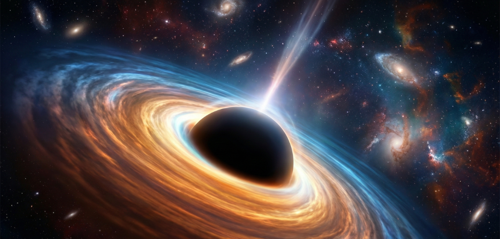

<div align="center">
  

  <h1>Black Hole Explorer & Quantum Chaos</h1>

  <p><strong>Interactive relativistic astrophysics and quantum chaos in the browser</strong></p>

  <p>
    <a href="https://rasidi3112.github.io/event-horizon-js/">
      
    </a>
    <a href="https://api.nasa.gov/">
      
    </a>
    <a href="LICENSE">
      
    </a>
  </p>
</div>

<hr />

A client-side platform (Vanilla JS, no build step) that combines NASA imagery with real-time simulations of Schwarzschild/Kerr black holes, Hawking thermodynamics, and quantum-chaos diagnostics (OTOC, Lyapunov exponents).

**Live site:** https://rasidi3112.github.io/event-horizon-js/

## Features

*   **Physics engine** (`physics.js`): Schwarzschild radius $R_s = 2GM/c^2$, Hawking temperature $T_H = \hbar\kappa/(2\pi c k_B)$, and Bekenstein–Hawking entropy $S_{BH} = k_B c^3 A/(4G\hbar)$ with the Kerr area $A = 4\pi(r_+^2 + a^2)$.
*   **Quantum chaos:** MSS bound $\lambda_L \le 2\pi k_B T/\hbar$ and OTOC growth $C(t) \sim e^{\lambda_L t}$.
*   **Real-time 3D black hole** (`blackhole3d.js`): dependency-free WebGL ray tracer that integrates photon geodesics through Schwarzschild spacetime, with a thin accretion disk from the ISCO, Doppler beaming and gravitational redshift. It holds ~60 fps through adaptive resolution and falls back to a static image without WebGL. It drives the landing hero and an interactive card on the Simulations page.
*   **NASA gallery:** curated imagery from the NASA Image and Video Library API.

**Stack:** HTML5, CSS3, ES6+ JavaScript, Chart.js 4.4.1 (+ annotation 3.1.0), MathJax 3.2.2. All CDN scripts are version-pinned with SRI hashes.

## Getting Started

```bash
git clone https://github.com/rasidi3112/event-horizon-js.git
cd event-horizon-js
python3 -m http.server 8000   # or just open index.html
```

A local server avoids CORS issues with the NASA API.

**Tests** (Node 18+, no dependencies):

```bash
node --test tests/*.test.cjs
```

## Project Structure

```bash
.
├── index.html            # Main dashboard
├── advanced-math.html    # Mathematical derivations
├── simulations.html      # Interactive simulators
├── styles.css            # Design system & layout
├── physics.js            # Pure physics engine & black hole catalog (no DOM)
├── app.js                # UI logic & NASA API
├── blackhole3d.js        # WebGL ray-traced black hole
├── animations.js         # Scroll reveal animations
└── tests/physics.test.cjs
```

## Known Approximations

*   **Quasinormal modes:** eikonal limit; the Schwarzschild $\ell = 2$ fundamental mode's real part is ~29% off from Leaver's values (shown for reference).
*   **Page curve:** naive model without greybody factors or emission entropy; it peaks at $\approx 0.65\,t_{\rm evap}$ vs. $\approx 0.54\,t_{\rm evap}$ in Page (2013).
*   **Evaporation time** $t_{\rm evap} = 5120\pi G^2 M^3/(\hbar c^4)$ ignores greybody factors, particle species and spin.
*   **Spins** marked *assumed* in the catalog are placeholders; spin is capped at the Thorne limit $a_* = 0.998$.
*   **OTOC** models early-time growth only, without saturation. The **chaos-bound** and **complexity** charts are illustrative.
*   **3D renderer:** non-rotating hole, thin disk, approximate blackbody colours, procedural (non-MHD) disk texture.

## References

*   Maldacena, Shenker, Stanford, *A bound on chaos*, [arXiv:1503.01409](https://arxiv.org/abs/1503.01409)
*   Maldacena, Stanford, *Comments on the SYK model*, [arXiv:1604.07818](https://arxiv.org/abs/1604.07818)
*   Page, *Time Dependence of Hawking Radiation Entropy*, [arXiv:1301.4995](https://arxiv.org/abs/1301.4995)
*   Cardoso et al., *Geodesic stability, Lyapunov exponents and QNMs*, [arXiv:0812.1806](https://arxiv.org/abs/0812.1806)
*   Kokkotas, Schmidt, *Quasi-Normal Modes of Stars and Black Holes*, [arXiv:gr-qc/9909058](https://arxiv.org/abs/gr-qc/9909058)
*   Carmi et al., *Time Dependence of Holographic Complexity*, [arXiv:1709.10184](https://arxiv.org/abs/1709.10184)
*   Kehle, Unger, *Gravitational collapse to extremal black holes*, [arXiv:2211.15742](https://arxiv.org/abs/2211.15742)
*   Black hole catalog data: [arXiv:2102.09091](https://arxiv.org/abs/2102.09091) (Cyg X-1), [arXiv:1904.05721](https://arxiv.org/abs/1904.05721) (Sgr A*), [arXiv:1906.11243](https://arxiv.org/abs/1906.11243) (M87*), [arXiv:1811.12907](https://arxiv.org/abs/1811.12907) & [arXiv:2508.18082](https://arxiv.org/abs/2508.18082) (GWTC), [arXiv:1601.05151](https://arxiv.org/abs/1601.05151) (NGC 1277), [arXiv:1907.10608](https://arxiv.org/abs/1907.10608) (Holm 15A), [arXiv:1509.04782](https://arxiv.org/abs/1509.04782) (Phoenix A), [arXiv:1409.2453](https://arxiv.org/abs/1409.2453) & [arXiv:astro-ph/0606076](https://arxiv.org/abs/astro-ph/0606076) (GRS 1915+105)

## Contributing

Pull requests are welcome. Cite sources (arXiv or textbooks) for any physics change and make sure `node --test tests/*.test.cjs` passes.

## License

MIT. See [`LICENSE`](LICENSE).
